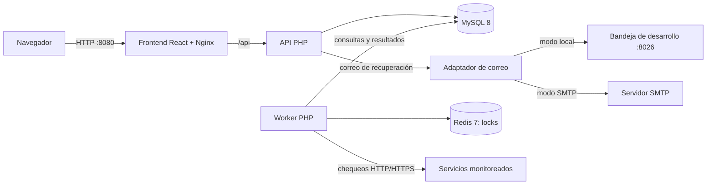

# StatusHub

Servicio web de monitoreo de disponibilidad multi-cliente (Software Libre — Licencia MIT).

## Proyecto

StatusHub permite que cada cliente registre servicios HTTP/HTTPS, consulte su disponibilidad e historial de latencia, revise y exporte incidentes, y publique una página de estado personalizada para sus propios clientes.

- `aplicacion/frontend`: SPA React/TypeScript/Vite servida por Nginx con proxy `/api` al backend.
- `aplicacion/backend/public`: punto de entrada HTTP de PHP con manejo de CORS (incluyendo `OPTIONS`).
- `aplicacion/backend/src`: configuración, persistencia PDO/Redis, zona horaria (`America/Argentina/Buenos_Aires`), autenticación, servicios, incidentes y worker.
- `aplicacion/mail-adapter`: servicio aislado para envío de correos de recuperación (bandeja local `:8026`, API HTTPS de Brevo o SMTP).
- MySQL 8 y Redis 7: persistencia relacional y locks de concurrencia para el worker.

### Arquitectura



## Funcionalidades principales

### Cuentas, autenticación y configuración

- Registro con validación de email, reglas de contraseña segura (mínimo 8 caracteres, mayúscula, minúscula y número) y aceptación de **Términos y Condiciones (Software Libre MIT)**.
- Validación por campo con borde rojo y mensajes descriptivos en Login, Registro, Recuperación y Cambio de contraseña.
- Recuperación de contraseña mediante enlace de un solo uso válido por 1 hora (cierra sesiones previas).
- Sección **Configuración** con activación/desactivación de página pública, **nombre de organización obligatorio** al publicar, preferencias locales del panel (auto-actualización y vista inicial), cambio de contraseña y **baja definitiva de cuenta** (eliminación en cascada).

### Dashboard, servicios y gráficos

- Disponibilidad global de los últimos 30 días (calculada sobre la duración real del período con recorte de incidentes previos) y resumen de servicios operativos/caídos.
- Gráfico de **Disponibilidad Histórica (Últimas 24 hs)** y vista de servicios en **Grilla compacta** o **Listado** con buscador en vivo.
- Modal de detalle por servicio con KPIs (uptime, nivel, tiempo de caída, latencia, HTTP, intervalo), **gráfico de latencia de 24 hs con desglose minuto a minuto** y últimos incidentes.
- Regla de monitoreo según SRS: códigos HTTP `200–499` saludables; HTTP `5xx`, timeout `> 5 s`, DNS, SSL/TLS y errores de conexión se registran como caída con `failure_type`.

### Notificaciones, incidentes y página pública

- La campana de notificaciones despliega un **popover** con los incidentes abiertos; al hacer clic en uno navega al historial abriendo su detalle.
- **Historial de Incidentes** paginado (10/20/50 por página) con filtros por servicio, estado y fechas, modal con fecha/hora de **Detectado**, **Resuelto** y **Tipo de Fallo**, y exportación a CSV UTF-8.
- **Página de Estado Pública** (`/status/<slug>`): privada por defecto; al compartirse por enlace muestra el nombre de la organización y solo los servicios públicos en modo solo lectura estricto (sin botones de admin ni enlaces clickeables a los endpoints).

## Servicios locales y puertos

| Servicio | Uso | Acceso local |
|---|---|---|
| Frontend (Nginx) | Interfaz web y proxy de `/api` | `http://localhost:8080` |
| Backend (PHP 8.2) | API REST | `http://localhost:8081` |
| Adaptador de correo | Bandeja local de desarrollo o envío SMTP | `http://localhost:8026` |
| MySQL 8 | Base de datos de la aplicación | `127.0.0.1:3306` |
| Redis 7 | Locks de concurrencia del worker | `127.0.0.1:6379` |
| Worker | Chequeos periódicos de servicios | Servicio interno de Docker |

## Levantar en local

Desde la raíz del repositorio:

```bash
docker compose up -d --build
```

Abre `http://localhost:8080/` para usar StatusHub y `http://localhost:8026/` para la bandeja local de recuperación de contraseña. En despliegues productivos reemplaza los secretos en `.env`, configura `MAILER_MODE=brevo` (recomendado en Railway Free/Trial/Hobby) o `MAILER_MODE=smtp` (Railway Pro/VPS) y habilita HTTPS/TLS en el proxy inverso.

## Validaciones y tests unitarios

```bash
# Backend: sintaxis PHP y suite unitaria standalone (sin Composer)
docker compose exec backend sh -c 'for f in $(find src public bin tests -name "*.php"); do php -l "$f"; done'
docker compose exec backend php tests/run-standalone.php

# Backend: PHPUnit (requiere Composer)
cd aplicacion/backend && composer install && composer test

# Frontend: compilación, lint y Vitest
npm --prefix aplicacion/frontend run build
npm --prefix aplicacion/frontend run lint
```

Consulta `aplicacion/README-TESTS.md` para ejecutar Vitest + cobertura en el frontend.

## Documentación

- [Manual de Usuario (PDF)](Manuales/ManualdeUsuarioStatusHub.pdf)
- [Manual de Despliegue (PDF)](Manuales/ManualdeDespliegueStatusHub.pdf)
- [Especificación de Requisitos (SRS v1.5)](SRS/SRS_StatusHub.md)
- [Arquitectura](ARQUITECTURA/ARQUITECTURA_StatusHub.md)
- [Modelo de Datos (DER)](diagramas/db/statushub-db.mmd)
- [Seguimiento de Tareas](TAREAS/TAREAS_StatusHub.md)

## Demo 

- [StatusHub](https://radiant-celebration-production-545c0b7c.up.railway.app/)

La demo se encuentra levantada en el servicio *railway.com*
