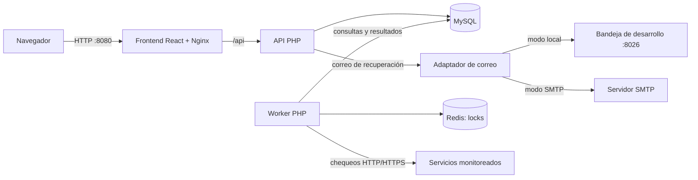

# StatusHub

Servicio web de monitoreo de disponibilidad multi-cliente.

## Proyecto

StatusHub permite que cada cliente registre servicios, consulte su disponibilidad, revise incidentes y comparta una página de estado pública. La interfaz sigue el prototipo de `aplicacion/prototipo/statushub_app.html` y la solución separa frontend, API y worker:

- `aplicacion/frontend`: SPA React/TypeScript/Vite, con HTML, CSS y lógica separados; consume la API REST.
- `aplicacion/backend/public`: punto de entrada HTTP de PHP.
- `aplicacion/backend/src`: configuración, persistencia, autenticación, endpoints y checker por módulos.
- MySQL: clientes, servicios, verificaciones e incidentes.
- Redis: locks de concurrencia para el worker.
- Nginx: archivos estáticos del frontend y proxy `/api` al backend.

El frontend incluye autenticación, dashboard privado, gestión de servicios, historial/exportación de incidentes y página pública con búsqueda. Los datos se guardan en MySQL y el worker los actualiza.

### Arquitectura



## Funcionalidades

### Cuentas y autenticación

- Registro con validación de email, aviso cuando el correo ya está registrado y confirmación de contraseña.
- Las contraseñas deben tener al menos 8 caracteres, una mayúscula, una minúscula y un número. La regla se valida tanto en el frontend como en la API.
- El registro requiere aceptar los términos y condiciones, cuya constancia se guarda en la base de datos.
- La recuperación de contraseña envía un enlace de un solo uso, válido durante una hora. Solicitar un enlace nuevo invalida los anteriores; al cambiar la contraseña, se cierran las sesiones existentes.

### Dashboard y servicios

- Dashboard con disponibilidad global, resumen de servicios e incidentes abiertos.
- El panel se actualiza automáticamente y permite actualizarlo manualmente. El menú de usuario contiene la opción de cerrar sesión; la campana de notificaciones abre el historial de incidentes.
- Los servicios se pueden crear, editar y eliminar. El formulario valida nombre, URL HTTP/HTTPS e intervalo de chequeo (30–86400 segundos), y resalta los errores junto a cada campo.
- Cada servicio muestra su estado, disponibilidad, última verificación y visibilidad pública. La eliminación solicita confirmación en un diálogo propio de la aplicación.
- El buscador de servicios espera brevemente antes de aplicar el filtro. Los enlaces a los endpoints se abren en una pestaña nueva.
- El gráfico de latencia muestra las últimas 24 horas; se puede seleccionar una hora o hacer clic en una barra para consultar las verificaciones minuto a minuto.

### Incidentes y página pública

- El historial admite filtros por servicio, estado y fechas; las fechas futuras y los rangos invertidos se rechazan. Los resultados filtrados se pueden exportar como CSV.
- La página pública muestra los servicios publicados, su disponibilidad, latencia y una búsqueda con debounce. Los enlaces a los endpoints se abren en una pestaña nueva.
- En el dashboard, el sidebar permanece fijo y el área de contenido puede desplazarse de forma independiente; la navegación entre secciones usa desplazamiento suave.

## Servicios locales y puertos

`docker compose up --build` levanta estos servicios:

| Servicio | Uso | Acceso local |
|---|---|---|
| Frontend (Nginx) | Interfaz web y proxy de `/api` | `http://localhost:8080` |
| Backend (PHP) | API REST | `http://localhost:8081` |
| Adaptador de correo | Bandeja local de desarrollo o envío SMTP | `http://localhost:8026` |
| MySQL 8 | Datos de la aplicación | `127.0.0.1:3306` |
| Redis 7 | Locks del worker | `127.0.0.1:6379` |
| Worker | Chequeos periódicos de servicios | Servicio interno de Docker |

El esquema de MySQL se inicializa automáticamente al arrancar el backend. Las solicitudes de recuperación se limitan a 3 por correo y 10 por IP cada 15 minutos. Los datos del outbox de desarrollo se conservan en el volumen Docker `mail_data`.

## Recuperación de contraseña y adaptador de correo

El servicio aislado `aplicacion/mail-adapter` implementa la interfaz de correo utilizada por la API. Docker Compose inicia por defecto el adaptador en modo `local`: **no envía correos reales** y guarda los mensajes simulados en una bandeja disponible en `http://localhost:8026`. Para probar la recuperación local:

1. Inicia el stack con `docker compose up --build` y registra una cuenta en `http://localhost:8080`.
2. En la pantalla de inicio de sesión, selecciona **¿Olvidaste tu contraseña?** e ingresa el correo de esa cuenta.
3. Abre `http://localhost:8026` y usa **Abrir enlace de recuperación** en el mensaje nuevo.
4. Define una contraseña nueva desde el formulario. El enlace vence en una hora y solo puede usarse una vez.

La bandeja solo acepta conexiones desde la máquina local; en este modo no se envía correo real. Los mensajes simulados se conservan en el volumen Docker `mail_data`.

Para configurar envío real por un servidor SMTP compatible:

1. En `.env`, establece `MAILER_MODE=smtp`.
2. Completa `SMTP_HOST`, `SMTP_PORT`, `SMTP_USER`, `SMTP_PASSWORD` y `MAIL_FROM`. Ajusta `SMTP_SECURE` y `SMTP_REQUIRE_TLS` según el proveedor.
3. Usa valores aleatorios privados para `MAILER_API_TOKEN`, `JWT_SECRET` y las credenciales de MySQL. No agregues secretos al repositorio.
4. Reconstruye y levanta el stack con `docker compose up --build`.

En modo SMTP, la bandeja local devuelve 404. La solicitud de recuperación responde con un mensaje genérico para no revelar si una dirección de correo tiene una cuenta. El frontend incluye la ruta `/reset-password?token=<token>` para establecer la nueva contraseña.

Si ejecutas la interfaz con Vite, el proxy `/api` utiliza por defecto `http://localhost:8081`; configura `FRONTEND_ORIGIN=http://localhost:5173` para que los enlaces de recuperación regresen a Vite. Con Docker, el origen por defecto es `http://localhost:8080`.

## Documentacion

- [Arquitectura](ARQUITECTURA/ARQUITECTURA_StatusHub.md)
- [Especificacion de requisitos](SRS/SRS_StatusHub.md)
- [Seguimiento de tareas](TAREAS/TAREAS_StatusHub.md)

## Requisitos

- Docker y Docker Compose.
- Node.js 22 o superior y npm para desarrollo local del frontend.

## Levantar en local

Desde la raíz del repositorio, copia el archivo de entorno de ejemplo y levanta el frontend, API, worker, MySQL y Redis:

```bash
cp .env.example .env
docker compose up --build
```

Abre `http://localhost:8080/`. El esquema se crea automáticamente al arrancar. Para crear una cuenta, regístrate desde la pantalla inicial; luego agrega servicios HTTP/HTTPS desde el dashboard.

Para desarrollo solo del frontend, con la API Docker escuchando en el puerto 8080:

```bash
npm --prefix aplicacion/frontend ci
npm --prefix aplicacion/frontend run dev -- --host 0.0.0.0
```

El servidor Vite reenvía `/api` a `http://localhost:8081`. El enlace público tiene formato `/status/<slug>` y el slug se asigna al registrar el cliente.

Antes de desplegar fuera de desarrollo, reemplaza en `.env` las claves de ejemplo por valores aleatorios robustos y configura `FRONTEND_ORIGIN` para el dominio real. Los puertos de MySQL y Redis solo se publican en loopback.

## Validaciones

```bash
npm --prefix aplicacion/frontend run build
npm --prefix aplicacion/frontend run lint
docker compose config
```
